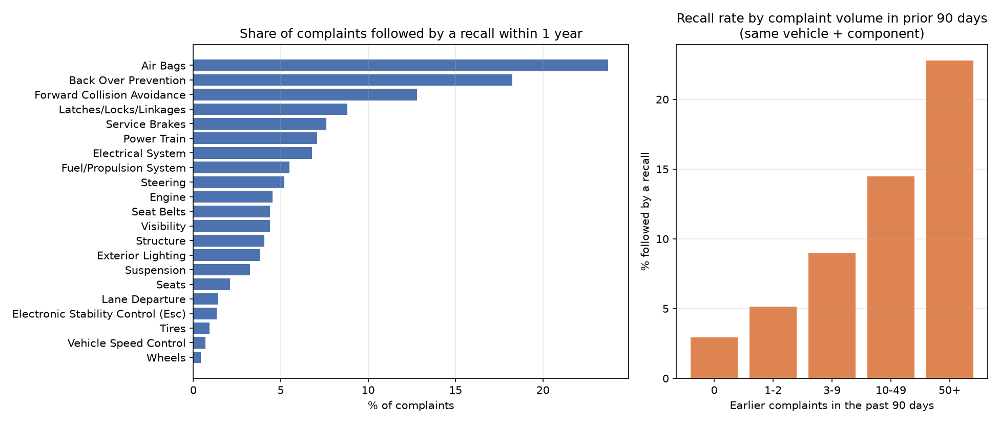
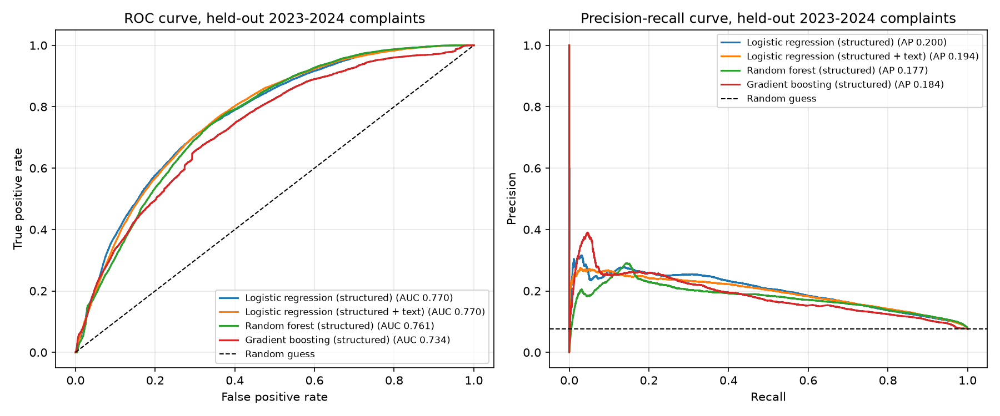
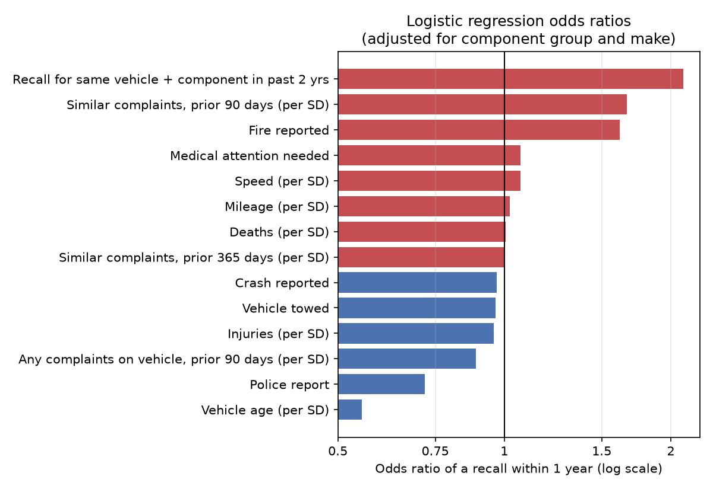

# Predicting Vehicle Recalls from NHTSA Safety Complaints

**Question:** When a driver files a safety complaint with the National Highway Traffic Safety Administration (NHTSA), can we predict whether that vehicle will be **recalled for the same problem within the next year**?

An accurate early-warning score could help regulators and manufacturers decide which complaints to investigate first.

**Tools:** Python (pandas, NumPy, scikit-learn, matplotlib), SQL (SQLite), Git

## Key results

* **About 800,000 complaints** (2015–2024) were loaded into a SQL database and linked to **246,000 recall records**. 7.5% of complaints were followed by a recall within a year.
* On complaints from **2023–2024, which the models never saw during training**, the best model reached **ROC AUC 0.77**. Among the 10% of complaints it ranked as highest risk, **25% led to a recall**, more than 3× the 7.6% base rate.
* **Simple beat complex.** Logistic regression matched or beat random forest and gradient boosting on future data. Adding complaint text (TF-IDF) helped in validation but not on the test years.
* **How you validate matters.** Random cross-validation folds overstated performance (AUC ≈ 0.88 vs. 0.77 on the test years). Year-by-year validation gave a realistic estimate.
* **Strongest signals:** a recent spike in similar complaints (OR 1.67 per SD), a recall for the same part in the past 2 years (OR 2.1), and fire (OR 1.6). Complaints about older vehicles were much less likely to be followed by a recall (OR 0.55 per SD of age).



## Data

Public flat files from NHTSA's Office of Defects Investigation ([NHTSA datasets](https://www.nhtsa.gov/nhtsa-datasets-and-apis)):

| File | Contents | Rows used |
|---|---|---|
| `COMPLAINTS_RECEIVED_2015-2019`, `2020-2024` | Consumer safety complaints: vehicle, component, crash/fire/injury flags, mileage, free-text description | 908,693 raw → 803,289 complaint × component rows |
| `FLAT_RCL_POST_2010` | Recall campaigns: vehicle, component, date the defect report was filed | 246,253 |

## Method

### 1. SQL data pipeline (`sql/build_dataset.sql`)

* **Cleaning:** kept vehicle complaints with a known model year, and collapsed one row per complaint × component group.
* **Component harmonization:** NHTSA renamed some categories over time (for example "ENGINE AND ENGINE COOLING" became "ENGINE"). A lookup table maps both complaints and recalls to one shared name.
* **Label:** `recall_within_1y = 1` if a recall for the **same make, model, model year and component group** was filed within 365 days **after** the complaint was received.
* **History features, built with SQL window functions:** the number of complaints about the same vehicle + component in the prior 90 and 365 days, and whether that vehicle + component had a recall in the prior 2 years. Every feature uses only information available on the day the complaint arrived, so nothing from the future leaks in.

### 2. Models (`scripts/04_train_models.py`)

| Model | Features |
|---|---|
| Logistic regression | Structured: crash, fire, injuries, deaths, towed, police report, mileage, speed, vehicle age, component, make, complaint source, complaint history |
| Logistic regression + text | Structured + TF-IDF of the complaint narrative (unigrams and bigrams, words only) |
| Random forest | Structured |
| Gradient boosting (HistGradientBoosting) | Structured |

### 3. Evaluation design

* **Out-of-time test set:** train on 2015–2021 and test on 2023–2024. 2022 is left out as a gap year, because a complaint's outcome takes a full year to observe. A model deployed in January 2023 could not yet know how 2022 complaints turned out.
* **Rolling validation:** for each year V from 2018 to 2021, train on 2015 through V−2 and validate on V.
* **Metrics:** ROC AUC, PR AUC (average precision; more informative when only ~7% of cases are positive), accuracy, and precision in the top 10% of risk scores.

## Results

**Held-out test set (2023–2024, n = 163,896, 7.6% positive)**

| Model | ROC AUC | PR AUC | Precision, top 10% | Accuracy |
|---|---|---|---|---|
| **Logistic regression (structured)** | **0.770** | **0.200** | **25.1%** | 92.2% |
| Logistic regression (structured + text) | 0.770 | 0.194 | 23.2% | 91.8% |
| Random forest (structured) | 0.761 | 0.177 | 20.9% | 92.3% |
| Gradient boosting (structured) | 0.734 | 0.184 | 22.5% | 92.0% |

**Rolling validation (mean over 2018–2021 validation years)**

| Model | ROC AUC | PR AUC | Precision, top 10% |
|---|---|---|---|
| Random forest (structured) | 0.754 | 0.166 | 16.5% |
| Logistic regression (structured + text) | 0.725 | 0.143 | 16.1% |
| Logistic regression (structured) | 0.713 | 0.138 | 15.0% |
| Gradient boosting (structured) | 0.713 | 0.162 | 16.4% |

**Why accuracy is not used to pick a model:** a model that predicts "no recall" for every complaint is already about 92% accurate, so accuracy cannot tell these models apart. The comparison relies on AUC and top-10% precision.





### Lessons learned

1. **The first validation was too optimistic.** The first version used random 5-fold CV grouped by vehicle and reported AUC ≈ 0.88, but the same models scored 0.73–0.78 on future years. Recall patterns shift over time (for example, the large Takata air-bag recalls of 2015–2017), so random folds let models learn era-specific patterns. Year-by-year validation fixed this.
2. **The first text model memorized identifiers.** Its strongest terms were recall campaign numbers (for example "15V313000") and model years that people typed into their complaints. Keeping only alphabetic words removed this. The text still adds little beyond the structured features.
3. **More flexible models overfit to the past.** Gradient boosting did best in early validation years but worst on the test years. When the data shifts over time, a well-specified logistic regression can be the more reliable choice.

## Limitations

* Recalls are matched to complaints by make, model, model year and broad component group. This is a proxy: a recall may address a different defect within the same component group.
* NHTSA updates complaint records over time (for example, reassigning components), so the public file may not show exactly what was known on the day a complaint arrived.
* Complaint narratives still mention model names, so some of the text signal is vehicle identity rather than defect description.

## Reproduce

Requires [uv](https://docs.astral.sh/uv/). Downloads about 170 MB of data and builds a roughly 750 MB SQLite database in `data/`.

```bash
./run_all.sh
```

Or step by step:

```bash
uv run python scripts/01_download_data.py    # download NHTSA flat files
uv run python scripts/02_load_to_sqlite.py   # load into data/nhtsa.db
uv run python scripts/03_build_dataset.py    # run sql/build_dataset.sql
uv run python scripts/04_train_models.py     # train, validate, test; write results/ and figures/
uv run python scripts/05_explore_figures.py  # exploratory charts
```

## Repository layout

```
scripts/   numbered pipeline steps (download → SQL → dataset → models → figures)
sql/       dataset construction: cleaning, harmonization, labels, window-function features
results/   metrics (CSV), odds ratios, top text terms
figures/   charts used in this README
```
